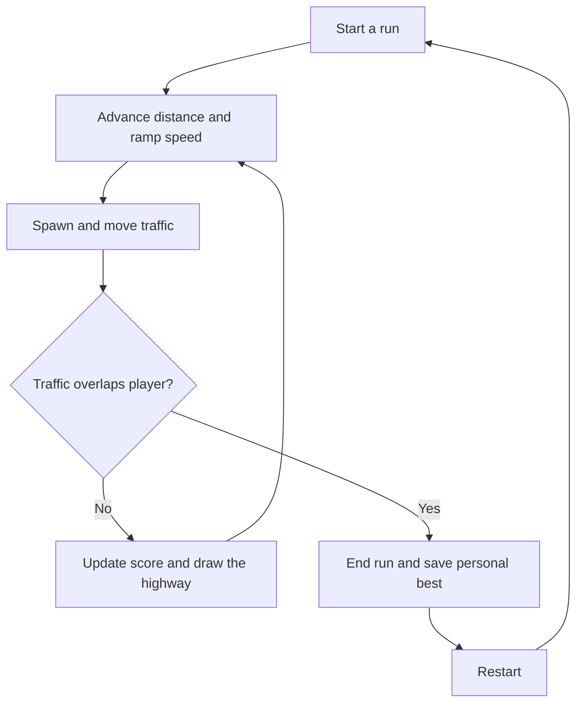

# Volt Lane

An endless neon night drive. Dodge original traffic cars, change lanes, and see how far you can make it through the city.

**Play:** [oscarmmi.github.io/neon-racer](https://oscarmmi.github.io/neon-racer/)

## How to play

- Use **← / →** or **A / D** to switch between the three lanes.
- On a phone or tablet, **tap either side of the road** or **swipe left / right**.
- Avoid traffic. Your distance score and speed both rise as you survive.
- After a collision, press **R** or choose **Run it back**. Your personal best is saved in this browser.

## Run locally

```sh
npm install
npm run dev
```

Run the game-logic tests and production build:

```sh
npm test
npm run build
```

## Game loop



## Built with

Vue 3, TypeScript, Vite, Canvas 2D, and Vitest. No backend or licensed racing brands.
